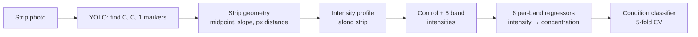

# LFA Detection

Computer-vision + neural-network pipeline for quantifying **lateral flow assay (LFA)** test strips from photographs.

A YOLO model locates the strip markers, the strip geometry is used to sample an intensity profile along the strip, six band intensities are read relative to the control line, per-band neural networks convert intensities to concentrations, and a final classifier predicts patient condition from the six concentrations.



## Repository layout

```
lfa-detection/
├── configs/config.yaml        # every path and tunable parameter
├── src/lfa/                   # reusable package
│   ├── config.py              #   config + path helpers
│   ├── data_check.py          #   patient CSV loading + multi-folder image lookup
│   ├── detection.py           #   YOLO loading, marker boxes, strip geometry
│   ├── signal_processing.py   #   intensity profile + peak/band extraction
│   ├── calibration.py         #   band positions, training-pair extraction
│   ├── models.py              #   per-band regressor, training, checkpoints
│   ├── inference.py           #   PatientPipeline (images → predictions)
│   ├── classification.py      #   condition classifier, CV, error analysis
│   └── visualization.py       #   all plotting
├── scripts/                   # run in order
│   ├── 01_calibrate_bands.py
│   ├── 02_build_dataset.py
│   ├── 03_train_regressors.py
│   ├── 04_predict_patients.py
│   ├── 05_classify_conditions.py
│   ├── check_data.py          #   run before 04: where is each CSV image found?
│   └── inspect_image.py       #   debug a single image
├── notebooks/
│   ├── LFA_Detection.ipynb    # organized, self-contained, runs end-to-end (e.g. on Colab)
│   ├── analysis.ipynb         # EDA + misclassified-image review (uses the `lfa` package)
│   └── LFA_Detection_original.ipynb   # original Colab notebook (outputs cleared)
├── tests/                     # synthetic-data tests, no weights required
├── data/                      # (gitignored) see data/README.md
├── models/                    # (gitignored) weights + calibration.json
└── results/                   # (gitignored) generated outputs
```

## Setup

```bash
python -m venv .venv && source .venv/bin/activate
pip install -e .            # installs the `lfa` package and dependencies
pip install -e ".[umap]"    # optional: UMAP embedding plot
pip install -e ".[dev]"     # optional: pytest
```

Put your YOLO weights at `models/best.pt` and your images under `data/` (layout in [`data/README.md`](data/README.md)). Paths are configurable in `configs/config.yaml`.

## Running the pipeline

**Option A — one notebook.** `notebooks/LFA_Detection.ipynb` is self-contained (no package install needed) and walks through all steps in numbered sections. Edit paths and parameters in section 1; each step saves its output so you can resume from any section. Its function cells are generated from `src/lfa/`, so the two stay equivalent.

**Option B — scripts** (better for reruns and automation):

```bash
python scripts/check_data.py              # optional: list every image to be analysed and where it was found
python scripts/01_calibrate_bands.py      # band positions (cm) -> models/calibration.json
python scripts/02_build_dataset.py        # (control, signal, concentration) tables per band
python scripts/03_train_regressors.py     # 6 regressors -> models/final_model_band{1..6}.pth
python scripts/04_predict_patients.py     # patient intensities + predicted concentrations
python scripts/05_classify_conditions.py  # condition classifier, CV report, misclassified images
```

All scripts accept `--config path/to/config.yaml`. Step 03 accepts `--bands 1 3` to retrain specific bands; step 05 accepts `--umap`.

Debug one image (shows the sampling path and detected peaks):

```bash
python scripts/inspect_image.py data/patient_samples/IMG_0001.jpg
```

| Step | Reads | Writes |
|------|-------|--------|
| 01 | `data/calibration/{1..6}/`, `models/best.pt` | `models/calibration.json`, `results/calibration/band_positions_raw.csv` |
| 02 | step 01 outputs | `results/datasets/band{1..6}.csv` |
| 03 | step 02 outputs | `models/final_model_band{1..6}.pth`, `results/regressors/` (metrics + plots) |
| 04 | patient CSV + `patient_samples/` images, **plus every image in** `positive_control/` (label `positive`) and `negative_control/` (label `negative`), all models | `results/patient_results/patient_predictions.csv` (includes `Image_Dir` / `Image_Path`), diagnostic plots |
| 05 | step 04 output | `results/patient_results/cv5/` (metrics, confusion matrix, misclassified images) |

## How it works

1. **Marker detection.** YOLO must find exactly two control markers (`C`) and one signal marker (`1`). The midpoint of the controls, the slope toward the `1` marker, and the pixel distance to it define the sampling line. The known real-world spacing (2.55 cm) converts pixels to centimetres.
2. **Intensity profile.** The green channel is averaged across the strip width along the sampling line, inverted (dark bands become peaks), smoothed (Savitzky-Golay), and baseline-corrected (Gaussian).
3. **Calibration (step 01).** On calibration images the first pass finds all 7 peaks (control + 6 bands); each band's position relative to the control is stored as mean ± std in cm.
4. **Band quantification.** On any image the control peak is found first, then each band is searched for within ±3σ of its calibrated position.
5. **Regression (step 03).** One MLP per band maps raw `[Control, Signal]` intensities to concentration (Huber loss, 5-fold CV, then refit on all data).
6. **Classification (step 05).** An MLP classifies patient condition from the six predicted concentrations, evaluated with stratified 5-fold CV using out-of-fold predictions.

## Known issues

These come from the original notebook and are preserved on purpose so results are reproducible. Decide deliberately before changing them.

1. **Track-width scaling.** The strip is averaged over `arange(-(w//2), w//2)` pixel columns but divided by `w`. For the default odd `track_width=15` that is 14 columns / 15, so all intensities are scaled by 14/15. It is applied identically to training and patient images (they share one `sample_signal_using_distance`, which takes the **maximum signal inside each band's ±3σ window**), so it is consistent, but fixing it changes intensities and requires retraining (steps 02-05).
2. **Vertical marker layouts.** If a control marker and the `1` marker share the same x-coordinate, the slope is undefined and that image is skipped (logged).
3. **`HIV1` and `positive` are separate classes.** Labels that differ only by case (`Negative` / `negative`) are merged automatically, so negatives from the CSV and from `negative_control/` form one class. But the CSV labels HIV-positive samples `HIV1` while `positive_control/` images are labelled `positive`, so the classifier sees three classes (`HIV1`, `Negative`, `positive`). To treat `positive` as `HIV1`, set `classifier.condition_aliases: {positive: HIV1}` (see `data/README.md`).
4. **Class balance for step 05.** Stratified 5-fold CV requires at least 5 labelled samples in every condition.

## Tests

```bash
pip install -e ".[dev]"
pytest
```

Tests use a synthetic strip image and a fake YOLO model, so no weights or data are needed. The PyTorch-dependent modules (`models.py`, `classification.py`, `inference.py`) are not covered by the synthetic tests yet.

## Data and privacy

Do **not** commit patient images, the patient CSV, or generated results. `.gitignore` excludes `data/`, `models/` and `results/` by default. Share model weights through GitHub Releases or Git LFS. Clear notebook outputs before committing (they can embed images).

## License

MIT, see [LICENSE](LICENSE).
